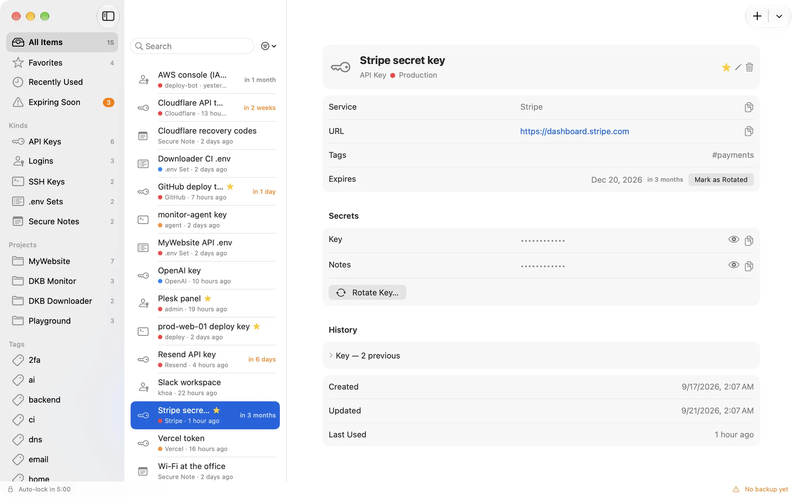
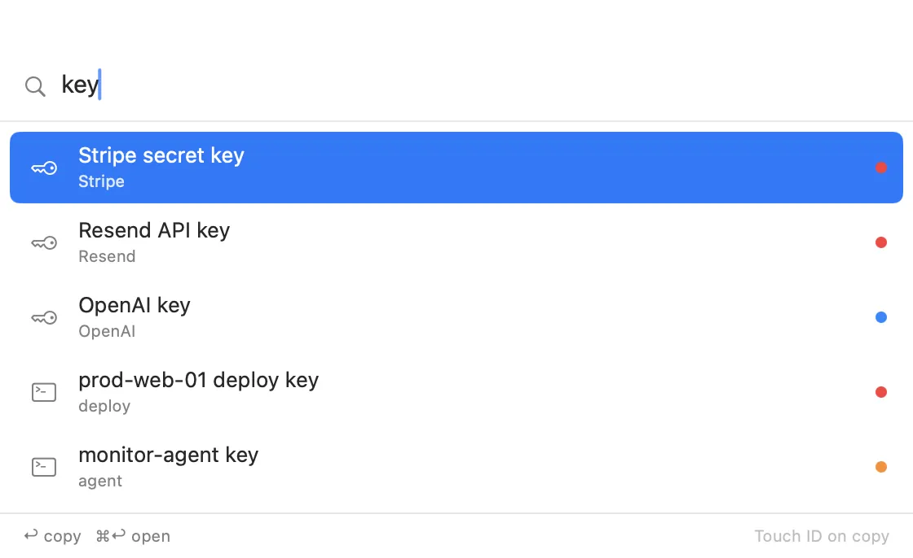

# KeyCellar

A personal, native macOS vault for API keys, passwords, SSH keys, `.env` sets, secure notes
and 2FA recovery codes. One user, one Mac: no account, no server, no sync, and no network
access at all.

<picture><source media="(prefers-color-scheme: dark)" srcset="docs/screenshots/vault-dark.webp"></picture>

## How secrets are protected

- The vault's master key is a P-256 key generated **inside the Secure Enclave** with a
  `userPresence` access control. It never leaves the chip; its opaque handle is the only
  thing stored in the login Keychain.
- Every secret value is sealed with CryptoKit **HPKE** to that key and stored as ciphertext
  in SQLite. Reading one back goes through the Secure Enclave, which itself demands Touch ID
  or the login password. The app cannot skip that check.
- The app is sandboxed with **no network entitlement**, every window is hidden from
  screenshots and screen sharing, and copied secrets are marked concealed and cleared from
  the clipboard on a timer.
- Because the data is bound to this Mac's Secure Enclave, an encrypted, passphrase-protected
  backup (`.dkbsecret`) is a core feature, not an extra.

The full list of threats and what is not defended against is in
[docs/threat-model.md](docs/threat-model.md); how each protection was checked in the shipped
build is in [docs/security-audit-v1.md](docs/security-audit-v1.md).

### Verify it yourself

```zsh
codesign -d --entitlements - /Applications/KeyCellar.app
```

The output lists exactly two entitlements, `com.apple.security.app-sandbox` and
`com.apple.security.files.user-selected.read-write`: no network client, no debugger attach.

## What it does

- Six kinds of item: API keys (any token), logins, SSH keys, `.env` sets, secure notes and
  2FA recovery codes, with projects, tags, favourites and environments. Search runs over
  metadata only, so it never needs Touch ID.
- Reveal and copy through Touch ID. Values hide again after 30 seconds and the clipboard is
  cleared after 45 (both configurable).
- Rotation keeps the five previous values; expiry reminders arrive 14, 7, 1 and 0 days ahead.
- Recovery codes: copy the next unused one, tick codes off without Touch ID, see how many are
  left.
- Auto-lock on idle, sleep, screen lock or hide. Quick search from the menu bar or a global
  shortcut (⌥⌘S by default) in any app.
- Encrypted backups (PBKDF2 with 600,000 iterations, then AES-256-GCM), import by merge or
  replace, scheduled backups to a folder of your choice. `.env` import and export.
- English and Vietnamese, light and dark appearance.

<picture><source media="(prefers-color-scheme: dark)" srcset="docs/screenshots/quicksearch-dark.webp"></picture>

## Requirements

macOS 14 or later and a Secure Enclave: any Apple silicon Mac, or an Intel Mac with the T2
chip (2018 and later). Without one the app explains why and quits. The release build is
universal.

## Install

Download the latest version from
[apps.dangkhoabach.vn/dkb-secret](https://apps.dangkhoabach.vn/dkb-secret).

- The app is signed with a self-signed certificate, not an Apple Developer ID, so macOS
  blocks the first launch. Open it once from
  **System Settings → Privacy & Security → Open Anyway**.
- The first launch of each new build asks for your login password once to reach the
  Keychain item that holds the enclave key handle. Choose **Always Allow**.
- There is no update check, since the app has no network access. Replace the app in
  `/Applications` with a newer download; the vault stays where it is.
- **Make a backup before you store real secrets**, with a passphrase you keep outside this
  Mac. Without it the vault cannot be moved off this Mac's Secure Enclave.

KeyCellar was called DKB Secret up to version 1.0.1. It is the same app with the same bundle
identifier and vault, and backup files keep the `.dkbsecret` extension.

## How it works

- **`KeyCellarCore`** (Swift package: Foundation, CryptoKit and GRDB): models, SQLite
  storage, Secure Enclave and HPKE sealing, the vault service and the backup format. It is
  tested headless.
- **`KeyCellarApp`** (SwiftUI and AppKit): the vault window, menu bar quick search, global
  hot key, clipboard handling, auto-lock and scheduled backups.
- GRDB is the only third-party dependency, pinned in `Package.resolved`.

## Build from source

Requirements: Xcode 26 or later.

```zsh
cp Local.xcconfig.example Local.xcconfig   # ad-hoc signing, enough to build and run
./scripts/create-signing-cert.sh           # or: a stable self-signed identity
open KeyCellar.xcodeproj
```

`Local.xcconfig` (gitignored, only `CODE_SIGN_IDENTITY`) is the project's base configuration,
so the build fails until it exists rather than silently picking an identity. A stable identity
matters: the Keychain item's access list is tied to it.

Debug builds keep their own vault, separate from the one in `/Applications`, and accept
`--seed-sample-data`, `--reset-debug-vault`, `DKB_START_UNLOCKED=1` and `DKB_ALLOW_CAPTURE=1`
for development. None of these exist in Release.

Tests:

```zsh
cd KeyCellarCore && swift test   # 95 tests
xcodebuild test -project KeyCellar.xcodeproj -scheme KeyCellarApp -destination 'platform=macOS'   # 39 tests
```

Releases are built, verified and packaged locally: see [docs/release.md](docs/release.md).

## Forking

Change these before you ship your own build, so it neither shares data with the official app
nor opens its backups by mistake:

- `PRODUCT_BUNDLE_IDENTIFIER` in the Xcode project.
- The Keychain service in `KeyCellarCore/Sources/KeyCellarCore/Crypto/KeychainStore.swift`.
- The backup type (`UTExportedTypeDeclarations` in `KeyCellarApp/Info.plist` and
  `BackupManager.fileType`).

## Security

Please report vulnerabilities privately, as described in [SECURITY.md](SECURITY.md).

## Contributing

Issues are welcome. This is a personal project, so pull requests are read but may not be
merged.

## License

[MIT](LICENSE) for the source code. The KeyCellar name, app icon and logo are not covered by
the license; use your own for a fork.
